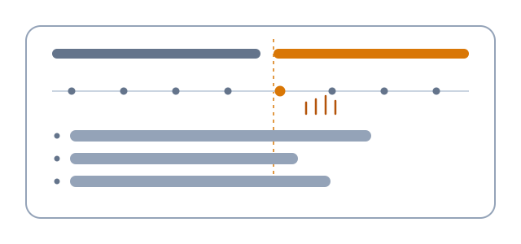
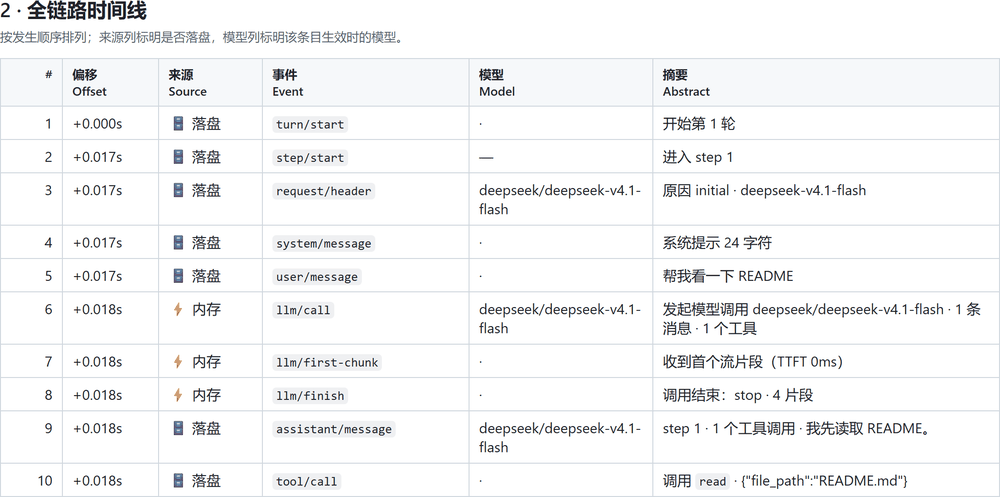

<div align="center">

# dsh-architecture-trace

**See what DSH is actually thinking.**

Flattens a whole turn — system prompt, request headers, every model call and streamed response, tool round-trips, TTFT, wrap-up — into one Markdown file you can read, search and diff: **a diagram of DSH's architecture that you can actually see**.

[](LICENSE)


[](https://github.com/aXYer-SI/dsh-architecture-trace/stargazers)

[中文](README.md) · [English](README.en.md) · [Live example](examples/session-demo/turn-01.md) · [Install](#install)

</div>



---

## ⚠️ Off by default — turn it off when you are done

The plugin **starts disabled**; nothing is recorded until you enable it in Settings → Plugins.

Prompts grow with the task, so `turn-NN.md` and `prompts.md` grow too: a long turn can write hundreds of KB or several MB, and a few sessions can fill a disk or stall a Markdown preview.

**Use it for small, short tasks**, then turn it off. The plugin also **disables its own row five minutes after a turn ends while idle**, and when the session is actually torn down — so it never keeps recording because you forgot about it.

> Why not "window closed"? DSH emits `session/disposed` only when a session is destroyed (deleted, or the app quits); a chat window that merely stays open never fires it. The only reliable "this task is finished" signal is the end of a turn, so idle time is the fallback.
>
> Two pitfalls are handled in 0.7.0: calling `pluginManager.setPluginEnabled` from inside the plugin fails with `HMR transactions cannot be nested`, so the switch is written straight into the profile's `cordis.patch.yml`; the deadline is persisted, so a plugin reload or restart still restores the countdown. Every step lands in the session's `auto-disable.log` (`armed` / `restored` / `fired` / `disabled`).

## You want this if —

- you are **reading DSH source** and want to see the exact system prompt the model received, and the exact shape of the tool list it was given;
- you are **debugging agent behavior** and need evidence, not guesses: how many steps, which one retried, why the turn ended;
- you are **comparing models or settings** and want TTFT, tok/s, context size and tool round-trip counts;
- you want to **keep a run** — a great one or a spectacular failure — for a write-up or a bug report.

## What it looks like in 30 seconds

```md
## 1 · Model track

This turn has 2 model segments and **1 switch**.

| 段<br>Segment | 模型<br>Model | 起始<br>Start | 持续<br>Duration | 该段调用<br>Calls | 触发<br>Cause |
|--:|---|---|--:|--:|---|
| 1 | `deepseek/deepseek-v4.1-flash` | +0.006s | 268ms | 1 | `initial` |
| 2 | 🔀 `workbuddy/glm-5.3` | +0.274s | 0ms | 1 | `change` |

> 🔀 **Model switch**: `deepseek/deepseek-v4.1-flash` → `workbuddy/glm-5.3` (+0.274s)

## 2 · Full timeline

| # | 偏移<br>Offset | 来源<br>Source | 事件<br>Event | 模型<br>Model | 摘要<br>Abstract |
|--:|--:|---|---|---|---|
| 3 | +0.006s | 🗄 durable | `request/header` | deepseek/deepseek-v4.1-flash | reason initial |
| 4 | +0.006s | 🗄 durable | `system/message` | · | system prompt 24,706 chars |
```

A complete turn is in the [live example](examples/session-demo/turn-01.md).

## Rendered example

<p align="center">
  
</p>

<p align="center"><sub>From the synthetic example (<code>examples/session-demo</code>): 🗄 durable ↔ ⚡ in-memory, complete summaries, bilingual headers</sub></p>

## What it records

| Badge | Source | Content | Replayable |
|---|---|---|---|
| 🗄 **Durable** | `session/event` (session log) | system prompt, request headers, final model messages, tool calls and results, turn boundaries | yes |
| ⚡ **In-memory** | `llm/stream`, `agent/status`, `agent/request-error` | **every model request** and its streamed response, TTFT, duration, chunk statistics, status transitions, request failures | no, gone with the process |

This is the part the plugin is pedantic about: every line is labelled with its layer, the timeline has a Source column, and section headings carry their layer too. You never mistake a live-only sample for a replayable log entry.

**The ⚡ layer can be switched off entirely.** With `captureRealtime: false` the plugin attaches neither `llm/stream`, `agent/status` nor `agent/request-error`, and the file keeps only the replayable 🗄 part. That is the cheapest way to answer "what happened this turn" without the per-request performance detail.

## Highlights

- **Two layers, never blurred.** Durable log and one-shot in-process activity are recorded and rendered separately.
- **Model switches stand out.** Segment table, 🔀 banners, a model column in the timeline, and field-level diffs in the request headers.
- **A performance ledger.** Message counts, characters, tool counts, TTFT, total duration, tokens, tok/s per request.
- **Failures leave a trace.** Retries, request errors and cancelled attempts appear in §5.x and §8 instead of vanishing.
- **Complete summaries.** Timeline summaries keep the whole text by default; `summaryMaxChars` narrows them when you want that.
- **Two-line table headers.** Chinese on the first line, English on the second (`摘要` / `Abstract`), so narrow columns never break a label mid-word.
- **Non-invasive.** No tools registered, no network requests, no prompt changes — it only listens to DSH events.
- **Never breaks a task.** Every hook is wrapped in `try/catch`; a recording failure logs one warning.

## Benchmarking a model with it

The plugin records **every request actually sent**, not just the final answer, so it doubles as a reproducible, archivable model benchmark.

| Metric | Where | Meaning |
|---|---|---|
| Time to first token | §7 per call, §2 timeline | request sent → first stream chunk |
| Total duration | §7 | request start → stream end |
| Generation speed | §7 | output tokens ÷ duration (tok/s) |
| Output size | §7 | output characters, reasoning characters, chunk counts |
| Context size | §7 / §4 | messages, characters, tool count, full request header |
| Finish reason | §7 / §8 | `stop` / `tool-calls` / error / cancelled |

How to compare meaningfully:

1. **Same prompt, different model**: switch models mid-turn (🔀) and compare each segment's §7 detail in §1's model track;
2. **Same model, different settings**: change reasoning effort, maxTokens or the tool set, then compare the §4 header diff with the §7 numbers;
3. **Look at the tail, not the average**: §7 lists every request, including retries and failures;
4. **Keep the result**: a few `turn-NN.md` files side by side are an experiment log.

⚠️ TTFT and tok/s depend heavily on the network and server load; a single number means little, repeated runs on one machine mean something. Turn `captureRealtime` off when you want purely durable data.

## Install

### Option 1 — DSH plugin market index (recommended)

1. Settings → Plugins → enable the experimental plugin market bundle if you have no Discover tab;
2. Add this index URL in Discover:

   ```
   https://raw.githubusercontent.com/aXYer-SI/dsh-architecture-trace/main/plugin-index.json
   ```

3. Search `architecture trace` and install — the row arrives **disabled**; enable it to start.

### Option 2 — Local directory

DSH → Settings → Plugins → Add plugin, pick this repository directory (the level containing `package.json`), then enable the `architecture-trace` row.

### Option 3 — CLI

```powershell
plugin_manager install_bundle target="D:\path\to\dsh-architecture-trace"
```

Installation links the directory: edit the source and refresh DSH — no reinstall. Enable the row yourself: it ships disabled. Requires DSH desktop (profile launch); Node.js ≥ 20 is for development and tests only.

## What using it feels like

1. Install it and work as usual — no habit change;
2. At the end of each turn, `dsh-traces/session-xxxx/turn-NN.md` appears (300 ms debounce, immediate flush at turn end);
3. Open it and read from §0 down, or search for `request/header` / `tool/call`.

## Output layout

Written to `dsh-traces/` in the session's working directory by default:

```
dsh-traces/
├── 00-格式说明.md              ← reading guide (written on first use)
└── session-xxxx/
    ├── index.md                ← turn index
    ├── prompts.md              ← prompt journal: what was sent, what came back
    ├── turn-00.md              ← auxiliary calls outside a turn
    └── turn-01.md              ← the full first turn
```

## The nine sections of a turn file

| Section | Content | Layer |
|---|---|---|
| 0 · Overview | duration, steps, model track, switches, tool count, tokens | mixed |
| 1 · Model track | **which models took part, when the switch happened, calls per segment** | 🗄 + ⚡ |
| 2 · Full timeline | everything in order, with source and current-model columns | 🗄 + ⚡ |
| 3 · Prompts | the complete `system/message` text | 🗄 |
| 4 · Request headers | model config, tool list, field diff against the previous version | 🗄 |
| 5 · Model output | reasoning / text / tool requests for every step | 🗄 |
| 6 · Tool calls | arguments, results, duration, success or failure | 🗄 |
| 7 · Model conversation detail | request size, TTFT, duration, characters, tokens, tok/s | ⚡ |
| 8 · Wrap-up | end reason, errors, other events | 🗄 |

§5 and §7 complement each other: §5 is the durable final message, §7 is the call site where retries and per-chunk streams show up. For performance work, read §7.

## Spotting a mid-turn model switch

1. **§0 Overview** — model track shows `A → B`, switch count shows `🔀 N`;
2. **§1 Model track** — segment table plus a `🔀` banner;
3. **§2 Timeline** — the model column, with `🔀` on the `request/header` row where the switch happened;
4. **§4 / §5 / §7** — field-level diffs and switch banners.

The authority is the durable `request/header` event (reason `change`); the ⚡ calls confirm which model was actually used.

## Prompt journal (prompts.md)

Each session also writes `prompts.md`: **the messages the harness actually sent** plus **the model's raw answer**, made for studying prompts.

- the first call shows the complete prompt (system prompt + user input);
- every later call lists only the **new** messages (tool results, new assistant turns) and says how many earlier ones were unchanged;
- when the context is compacted or reordered it falls back to the full prompt and says so;
- each call is followed by the answer: reasoning, text and tool calls, rebuilt from the stream.

It complements `turn-NN.md`: that file is the durable record (§3 system prompt, §7 every request), this one is the conversation as it happened. Set `capturePrompts: false` to skip it.

## Switching at runtime: `/trace-realtime`

No config edit needed to change what gets recorded:

```
/trace-realtime          # show the current state
/trace-realtime off      # durable 🗄 events only (the model stream is no longer recorded, no prompts.md)
/trace-realtime on       # durable + in-memory ⚡ (streams, status, request errors) and prompts.md
```

The switch lasts for this run only; reloading the plugin falls back to the configured `captureRealtime` / `capturePrompts`. After `off`, new turn files carry no ⚡ rows and §7 explains that no model call was captured.

## Configuration

On the plugin row, or in the profile's patch layer:

```yaml
- id: architecture-trace
  config:
    outputDir: "C:/Users/you/dsh-traces"  # empty = <session cwd>/dsh-traces
    captureRealtime: true                  # ⚡ master switch for the in-memory layer
    captureLlmCalls: true                  # ⚡ record every model call and stream
    capturePrompts: true                   # also write prompts.md
    autoDisable: 'idle'                    # idle | turn | session | false
    idleMinutes: 5                         # idle-mode wait
    summaryMaxChars: 0                     # summary budget; 0 keeps the whole text
    includeStream: false                   # include the per-chunk record
    includeRaw: false                      # include raw event JSON
```

| Option | Default | Meaning |
|---|---|---|
| `outputDir` | empty | absolute path; empty writes into each session's own working directory |
| `captureRealtime` | `true` | **master switch**. Off records no ⚡ events at all, leaving only durable 🗄 rows |
| `captureLlmCalls` | `true` | within the ⚡ layer, skip model calls and streams |
| `summaryMaxChars` | `0` | character budget for timeline summaries; `0` keeps the whole text |
| `includeStream` | `false` | larger files |
| `includeRaw` | `false` | for debugging the plugin itself |

## Example

[`examples/session-demo/`](examples/session-demo/) is a fully synthetic sample generated by the test suite, deliberately including a mid-turn model switch:

- [00-格式说明.md](examples/session-demo/00-格式说明.md) — reading guide
- [index.md](examples/session-demo/index.md) — turn index
- [turn-01.md](examples/session-demo/turn-01.md) — the full first turn

## Privacy

These files are raw, machine-oriented records: the full system prompt, the opening of user messages, tool arguments and results (file contents, command output, API responses), and model output including reasoning.

Before sharing, search for tokens, keys, internal hostnames and personal data. Pointing `outputDir` outside version control is the easier habit.

## Tradeoffs and known limits

- **Only sessions in this process are recorded.** History is not backfilled; use the `session_*` tools for old sessions.
- **The ⚡ layer is lossy by nature**: it dies with the process, and the file is a snapshot taken at render time. Chunk samples are capped at 300 per call.
- **One file per turn**; auxiliary calls outside a turn land in `turn-00.md`.
- **Complete summaries can grow the file**: a file-reading tool result of a few hundred thousand characters lands in the timeline; use `summaryMaxChars` to trim it.
- **No rotation, no cleanup**; output grows with use.
- **Chinese UI copy in 0.1.0**, and no interactive view on purpose — the output must stay greppable and diffable.

## Development

```powershell
node test/trace.test.mjs   # synthetic events + simulated stream: layers, switch, full summaries, durable-only mode
```

```
lib/index.js   plugin entry: session/event and llm/stream hooks, recording state, debounced flush
lib/render.js  pure rendering: turn record -> Markdown
lib/guide.js   body of 00-格式说明.md
```

## About the author

**aXyer** — independent developer with a long-standing interest in philosophy, Buddhism and psychology, now starting out with AI-assisted programming (vibe coding). This plugin is a by-product of learning to read DSH's internals.

A ⭐ is enough if it saves you some source reading; issues and pull requests welcome.

## License

[MIT](LICENSE) © 2026 aXyer
