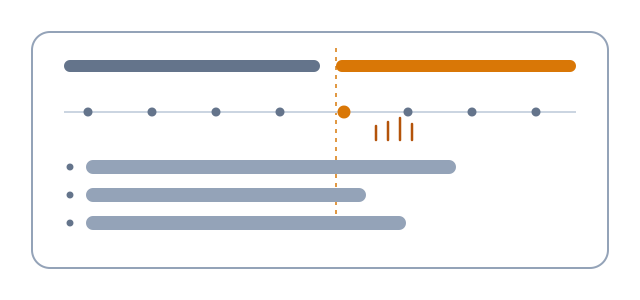
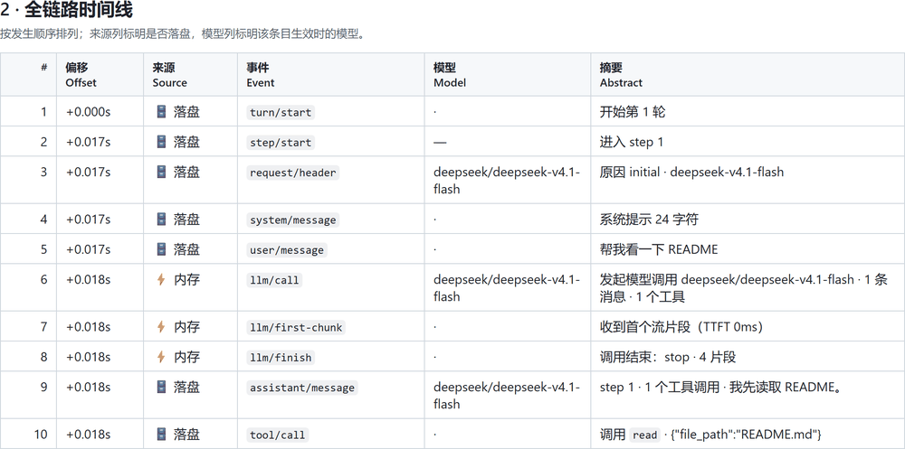

<div align="center">

# dsh-architecture-trace

**看得见 DSH 在想什么。**

把一轮任务的完整链路——系统提示、请求头、每一次模型调用与流式响应、工具往返、TTFT、收尾——按时间摊平成一份能读、能搜、能 diff 的 Markdown，是一份**看得见的 DSH 架构图**。

[](LICENSE)


[](https://github.com/aXYer-SI/dsh-architecture-trace/stargazers)

[中文](README.md) · [English](README.en.md) · [在线示例](examples/session-demo/turn-01.md) · [一键安装](#安装)

</div>



---

## 你会需要它，如果你——

- **在读 DSH 源码**，想知道「模型真正收到的系统提示长什么样」「工具清单是以什么形式塞进去的」；
- **在调 Agent 行为**，需要证据而不是猜测：这条路走了几步、哪一步重试了、为什么结束；
- **在比较模型或配置**，想量 TTFT、tok/s、上下文规模、工具往返次数；
- **想把一次惊艳（或翻车）的运行留下来**，事后复盘、贴给别人看、写进文章。

## 30 秒看懂它长什么样

```md
## 1 · 模型轨道

本轮共 2 段模型轨道，发生 **1 次 🔀 切换**。

| 段 Segment | 模型 Model | 起始 Start | 持续 Duration | 该段调用 Calls | 触发 Cause |
|--:|---|---|--:|--:|---|
| 1 | `deepseek/deepseek-v4.1-flash` | +0.006s | 268ms | 1 | `initial` |
| 2 | 🔀 `workbuddy/glm-5.3` | +0.274s | 0ms | 1 | `change` |

> 🔀 **模型切换**：`deepseek/deepseek-v4.1-flash` → `workbuddy/glm-5.3`（+0.274s）

## 2 · 全链路时间线

| # | 偏移 Offset | 来源 Source | 事件 Event | 模型 Model | 摘要 Abstract |
|--:|--:|---|---|---|---|
| 3 | +0.006s | 🗄 落盘 | `request/header` | deepseek/deepseek-v4.1-flash | 原因 initial |
| 4 | +0.006s | 🗄 落盘 | `system/message` | · | 系统提示 24,706 字 |
```

完整的一轮在 [在线示例](examples/session-demo/turn-01.md) 里，直接点开就能读。

## 渲染效果

<p align="center">
  
</p>

<p align="center"><sub>示例会话（<code>examples/session-demo</code>）的渲染效果：🗄 落盘 ↔ ⚡ 内存，摘要完整、表头中英对照</sub></p>

## 它记什么

| 徽标 | 来源 | 内容 | 能否回放 |
|---|---|---|---|
| 🗄 **落盘** | `session/event`（会话日志） | 系统提示、请求头、最终模型消息、工具调用与结果、轮次起止 | 能 |
| ⚡ **内存** | `llm/stream`、`agent/status`、`agent/request-error` | **每一次模型请求**及其流式响应、TTFT、耗时、片段统计、状态迁移、请求失败 | 不能，进程结束即消失 |

这是整个插件最较真的一点：两类来源**逐行标注**，时间线带「来源」列，章节标题也标层。你不会误把「只存在于内存的现场」当成「可回放的日志」。

**⚡ 层可以整体关掉**：`captureRealtime: false` 时插件完全不记录非落盘事件——不再挂 `llm/stream`、`agent/status`、`agent/request-error` 三个钩子，文件里只剩可回放的 🗄 部分。只想要「这一轮发生了什么」而不需要逐次请求性能时，用这个开关最省。

## 亮点

- **两层不混淆**：可回放的日志与一次性的现场分开记录、分开渲染。
- **模型切换一眼可见**：分段表、🔀 横幅、时间线模型列、请求头字段 diff，四处同时留痕。
- **性能账本**：每次请求的消息数、字符数、工具数、TTFT、总耗时、token、tok/s。
- **失败也留档**：重试、请求失败、被取消的尝试都会写进 §5.x / §8，不会静默消失。
- **摘要完整**：时间线摘要默认不截断，`summaryMaxChars` 想收窄再收窄。
- **表头中英对照**：`摘要 Abstract`、`偏移 Offset`、`来源 Source`、`事件 Event`、`模型 Model`……所有表格都带英文列名。
- **零侵入**：不注册任何工具、不发任何网络请求、不改你的提示词；只在 DSH 事件上旁听。
- **记录失败绝不打断任务**：每个钩子都包了 `try/catch`，出问题只打一行警告。

## 用它测模型性能

它记录的不是「一次回答」，而是**每一次真实发出的请求**——所以它天然适合做模型基准，而且是可复现、可存档的那种。

| 指标 | 在哪看 | 含义 |
|---|---|---|
| 首字延迟 TTFT | §7 每次调用、§2 时间线 | 从请求发出到第一个流片段 |
| 总耗时 | §7 | 请求开始到流结束 |
| 生成速度 | §7 | 输出 token ÷ 耗时（tok/s） |
| 输出规模 | §7 | 输出字符、推理字符、片段数、tool 参数片段 |
| 上下文规模 | §7 / §4 | 请求消息数、字符数、工具数、完整请求头 |
| 结束原因 | §7 / §8 | `stop` / `tool-calls` / 错误 / 取消 |

怎么比才有意义：

1. **同一提示词换模型**：让模型在一轮中途切换（🔀），然后在 §1 模型轨道里逐段对比 §7 的明细；
2. **同一模型换配置**：改推理力度、maxTokens、工具集，对比 §4 的请求头字段 diff 与 §7 指标；
3. **看长尾而不是平均**：§7 逐次列出每一个请求，重试和失败的调用也在里面，不会被平均值抹平；
4. **把结论留下来**：几份 `turn-NN.md` 并排 diff，本身就是实验记录。

⚠️ TTFT 和 tok/s 受网络与服务端负载影响很大，单次数字只作参考；同一天、同一台机器上多次对比才说明问题。想看纯落盘数据（不含这些 ⚡ 指标）时，把 `captureRealtime` 关掉即可。

## 安装

### 方式一：DSH 插件市场索引（推荐）

1. 设置 → 插件 → 启用「实验性插件市场」bundle（若还没有 Discover 标签页）；
2. 在 Discover 里添加索引 URL：

   ```
   https://raw.githubusercontent.com/aXYer-SI/dsh-architecture-trace/main/plugin-index.json
   ```

3. 搜索 `architecture trace`，点安装。

### 方式二：本地目录

打开 DSH → 设置 → 插件 → 添加插件，选择本仓库目录（含 `package.json` 的那一层），然后在列表里启用 `architecture-trace`。

### 方式三：命令行

```powershell
plugin_manager install_bundle target="D:\path\to\dsh-architecture-trace"
```

安装是**链接**方式：之后改动本目录源码，刷新 DSH 即生效，不必重装。要求 DSH 桌面版（profile 启动）；Node.js ≥ 20 只用于开发与测试，运行时由 DSH 提供。

## 用起来是什么感觉

1. 装好，正常干活——不需要改任何习惯；
2. 每轮结束，`dsh-traces/session-xxxx/turn-NN.md` 自动出现（写入防抖 300 ms，轮末立即落盘）；
3. 打开它，从 §0 概览往下读，或者直接搜 `request/header`、`tool/call`。

## 输出结构

默认写到**当前会话工作目录**下的 `dsh-traces/`：

```
dsh-traces/
├── 00-格式说明.md              ← 阅读指南（首次写入时生成）
└── session-xxxx/
    ├── index.md                ← 轮次索引
    ├── turn-00.md              ← 轮次外的辅助调用（标题生成等）
    └── turn-01.md              ← 第 1 轮全过程
```

## 一轮文件里的 9 个章节

| 章节 | 内容 | 层 |
|---|---|---|
| 0 · 概览 | 耗时、步数、模型轨道、切换次数、工具次数、Token | 混合 |
| 1 · 模型轨道 | **哪些模型先后参与、何时切换、各段调用几次** | 🗄 + ⚡ |
| 2 · 全链路时间线 | 按发生顺序排列，带来源列与当前模型列 | 🗄 + ⚡ |
| 3 · 提示词 | `system/message` 全文 | 🗄 |
| 4 · 请求头 | 模型配置、工具清单、相对上一版的字段 diff | 🗄 |
| 5 · 模型输出 | 每步的推理 / 正文 / 工具调用（最终提交版） | 🗄 |
| 6 · 工具调用 | 参数、结果、耗时、成败 | 🗄 |
| 7 · 模型对话明细 | 每次请求的规模、TTFT、耗时、字符数、Token、tok/s | ⚡ |
| 8 · 收尾 | 结束原因、错误、其它事件 | 🗄 |

§5 与 §7 互补：§5 是落盘后的最终消息（一条调用一个结果），§7 是调用现场（重试、辅助调用、逐字流都在这里）。性能测试看 §7。

## 中途换模型怎么看出来

1. **§0 概览**：`模型轨道` 显示 `A → B`，`模型切换` 显示 `🔀 N 次`；
2. **§1 模型轨道**：分段表 + `🔀 模型切换：A → B` 横幅；
3. **§2 时间线**：新增「模型」列，切换处的 `request/header` 行带 `🔀`；
4. **§4 / §5 / §7**：字段级 diff 与切换横幅。

权威依据是落盘的 `request/header`（原因 `change`）；⚡ 的每次调用用于核对实际使用的模型。

## 配置

在插件行配置里填写，或写进 profile 的 patch 层：

```yaml
- id: architecture-trace
  config:
    outputDir: "C:/Users/you/dsh-traces"  # 留空 = 会话工作目录/dsh-traces
    captureRealtime: true                  # ⚡ 总开关：记录 / 不记录非落盘事件
    captureLlmCalls: true                  # ⚡ 开启时，记录每次模型调用与流式响应
    summaryMaxChars: 0                     # 摘要字数上限；0 = 完整不截断
    includeStream: false                   # 🗄 附带落盘的逐片段记录
    includeRaw: false                      # 附带原始事件 JSON
```

| 配置项 | 默认 | 说明 |
|---|---|---|
| `outputDir` | 空 | 绝对路径；空表示写到各会话自己的工作目录 |
| `captureRealtime` | `true` | **总开关**。关掉后完全不记录 ⚡ 层，只剩可回放的 🗄 事件 |
| `captureLlmCalls` | `true` | 在 ⚡ 层开启的前提下，单独关闭模型调用与流式响应 |
| `summaryMaxChars` | `0` | §2 时间线摘要的字数上限；`0` = 保留完整文本 |
| `includeStream` | `false` | 打开后体积会明显变大 |
| `includeRaw` | `false` | 排查插件自身问题时用 |

## 示例

[`examples/session-demo/`](examples/session-demo/) 是一份**完全合成**的样例输出（由测试生成，不含真实会话内容），特意包含一次中途切换模型：

- [00-格式说明.md](examples/session-demo/00-格式说明.md) — 阅读指南
- [index.md](examples/session-demo/index.md) — 轮次索引
- [turn-01.md](examples/session-demo/turn-01.md) — 第 1 轮全过程

## 隐私提醒

这些文件是**给机器看的原始记录**，里面会出现：完整的系统提示、用户消息开头、工具参数与结果（可能是文件内容、命令输出、接口响应）、以及模型输出（含推理）。

分享前请先搜一遍 token、密钥、内网地址、个人信息。更省心的做法是把 `outputDir` 指到版本库之外的目录。

## 设计取舍与已知限制

- **只记录进程内发生的会话**，历史会话不回填；复盘旧会话请用 `session_*` 工具。
- **⚡ 层必然有损**：进程结束即消失，文件是当时渲染的快照；chunk 采样上限 300 条/次，超出标记 `samplesTruncated`。
- **一轮一文件**：轮次外的辅助调用落在 `turn-00.md`。
- **摘要默认完整，文件可能很大**：一次读文件类工具的结果可能几十万字，时间线会跟着变长；用 `summaryMaxChars` 收窄。
- **不轮转、不清理**：文件量随使用增长，需要你自行归档或删除。
- **首版界面文案为中文**；没有可交互视图是有意为之——它要能被 grep、被 diff、被放进版本库。

## 开发与测试

```powershell
node test/trace.test.mjs   # 合成事件 + 模拟流，校验两层渲染、模型切换、完整摘要与「只记落盘」模式
```

```
lib/index.js   插件入口：注册会话事件与模型流钩子，维护记录状态，防抖落盘
lib/render.js  纯渲染：把一轮的记录对象渲染成 Markdown
lib/guide.js   00-格式说明.md 的正文
```

采集与渲染分离，所以测试可以只喂合成事件、比对 Markdown，不需要真的起一次模型调用。

## 关于作者

**aXyer** — 独立开发者，长期关注哲学、佛学与心理学，刚开始接触 AI 编程（vibe coding）。这个插件是作者学着读懂 DSH 内部机制时顺手的产物：把看不懂的时序，变成读得懂的文档。

如果它帮你省下了翻源码的时间，点个 ⭐ 就够了；有想加的事件或渲染章节，欢迎开 issue。

## 许可

[MIT](LICENSE) © 2026 aXyer
